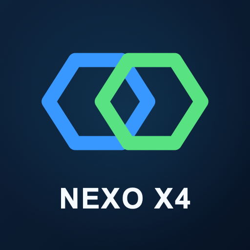

# Nexo X4

     

Nexo X4 is an independent, unofficial Xbox Cloud Gaming client for PS4 homebrew, built with the OpenOrbis toolchain. It combines the XCloud4 native streaming work with a PS4 adaptation of RafaelNGP's PSBox interface. It uses service interfaces without an official Nexo X4 integration or endorsement and is unaffiliated with Microsoft, Xbox, Sony, or PlayStation. See the [legal and service-use notice](docs/LEGAL.md) and [privacy and local-data notice](docs/PRIVACY.md) before signing in.

The first release is **v0.1.0** (`APP_VER` `01.32`). It provides Microsoft device-code sign-in, a catalog and game launch flow, DualShock 4 input, and native video and audio playback. In observed 720p sessions, normal play with compact statistics approached 60 frames per second; opening the large menu brought rendering to around 30 frames per second. These are observations, not promised frame rates. 1080p cloud streaming has not been validated.

The local **0.1.3 candidate** retains a 720p/60 profile (adaptive 3–8 Mbps) and an experimental 1080p/60 profile (adaptive 5–15 Mbps). The selected profile applies to the next session; requesting 1080p does not prove the service will deliver it. Adaptive bitrate requests work as follows: qualifying packet loss reduces the requested rate by 20%, followed by 250 kbps increases after 20 seconds of clean reception. Video output uses GPU DMA readback from write-combining memory to a CPU-cached buffer, then SSE2 color conversion and scaling. Public catalog metadata and images are fetched by a persistent refresh worker. Actual frame rate and network quality depend on the stream, console, and connection.

[Download the latest release](https://github.com/giruai/nexo-x4/releases/latest) · [Build guide](docs/BUILDING.md) · [Legal notice](docs/LEGAL.md) · [Privacy notice](docs/PRIVACY.md) · [Credits](CREDITS.md)

## Build and install

Build from source on Linux x86-64 with OpenOrbis and the complete patched dependency source archive for this release. See [Building](docs/BUILDING.md) for prerequisites, the toolchain and archive inputs, host checks, and package creation. The local 0.1.3 candidate produces `dist/Nexo-X4-v0.1.3-ps4.pkg` (`APP_VER` `01.35`). The published 0.1.0 release remains separate; 0.1.1 and 0.1.2 were earlier local candidates.

Install the resulting package through your usual PS4 homebrew package workflow. A legitimate Microsoft account, a supported region, and the access or entitlement required for the selected title are needed. Some titles, including Fortnite where Microsoft offers it for free, may not require a paid Game Pass subscription. Sign-in uses a public OAuth client identifier for compatibility; it is **not** a secret or a Nexo X4-owned app registration. Microsoft controls service availability and authorization, and this client cannot guarantee access or account standing.

The package retains title ID `XCLD00001` for migration compatibility. That ID is not the product name. This release ships with diagnostic mailbox control off, receiver NACK on, NACK grace at 0 ms, and rumble off.

## Project guide

- [Architecture](docs/ARCHITECTURE.md) describes the application boundaries and media path.
- [Building](docs/BUILDING.md) describes reproducible local build inputs and checks.
- [Credits](CREDITS.md) distinguishes incorporated work from research references.
- [Legal notice](docs/LEGAL.md) explains the software license, unofficial service integration, and access conditions.
- [Privacy notice](docs/PRIVACY.md) describes sign-in, local storage, network destinations, and diagnostics.
- [Third-party notices](THIRD_PARTY_NOTICES.md) and [retained license texts](docs/licenses/README.md) describe redistributed components and corresponding source.
- [Brand artwork](assets/branding/README.md) contains the editable icon source and its attribution.

Nexo X4 application code is licensed under [GPL-3.0-only](LICENSE). Incorporated third-party components retain their own notices and licenses. A distributed package must be accompanied by its matching application source and complete patched dependency source bundle; a list of upstream URLs alone does not describe the distributed dependency modifications.

## Candidate 0.1.1: video profiles and diagnostics

In **Options**, choose **720p / 60 FPS** or **1080p / 60 FPS (experimental)**. The selection is saved and applies when the next cloud session starts; changing it during play does not restart the game. The local in-game Options menu offers the same profile and a **Diagnostics** toggle. That toggle enables numeric input and render measurements and defaults off. Separately, the media pipeline writes a local numeric trace when a session closes, and basic lifecycle/error messages remain available. See [Privacy](docs/PRIVACY.md) for the distinction and local-data handling.

The local overlay now reuses rendered layers and copies opaque rectangles without reading the write-combined VideoOut buffer. This optimizes the local menu; the separate Xbox Guide is drawn by the remote service. Native 1080p output handling is implemented but cloud delivery and sustained console performance still require hardware validation. Resource provisioning remains cancellable and now allows up to 30 minutes; individual HTTP/TLS timeouts are unchanged.

## Candidate 0.1.2: resource wait information

The launch screen now shows elapsed wait, the latest optional Xbox estimate, available allocation/preparation components, estimate age, region and time since the last session-state reply. Estimates describe a title in its regional service context; they are not an individual queue position or a guaranteed countdown. A zero estimate does not mean the session is ready. The 30-minute local request limit is labelled separately.

While Xbox reports `WaitingForResources`, the worker queries the optional estimate at most once every 30 seconds through a separate HTTP context with a 3-second aggregate request deadline. Native context creation/cleanup are outside that deadline. Missing fields, rate limiting and estimate failures do not fail or restart the cloud session; the last valid value is retained and marked stale. No queue position, percentage or player count is invented. This candidate preserves the video profiles, adaptive bitrate, local menu changes and optional diagnostics from 0.1.1. Host checks and a native package build do not validate these changes on console.

## Candidate 0.1.3: release documentation

The local 0.1.3 candidate retains the 0.1.2 streaming and queue behavior and adds the [legal notice](docs/LEGAL.md) and [privacy notice](docs/PRIVACY.md) for release review. It remains separate from the published 0.1.0 release. Build output and hardware validation for 0.1.3 must be reported separately from checks on earlier candidates.
