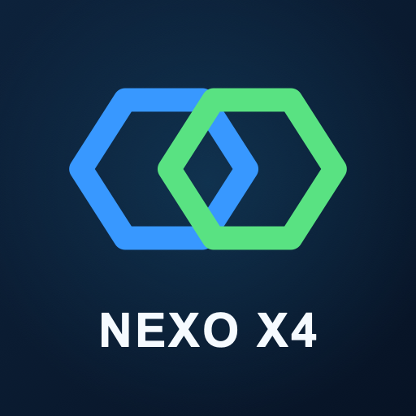

# Nexo X4

**An independent Xbox Cloud Gaming client for PS4 homebrew.** Nexo X4 combines XCloud4's native streaming foundation with a PS4 adaptation of RafaelNGP's PSBox catalog interface. It is unofficial and unaffiliated with Microsoft, Xbox, Sony or PlayStation.

**Current stable release: 0.2.2.** This release adds an independent install identity, explicit saved-session migration, service-offered region selection and game-friendly Options/touchpad controls. Native 720p and 1920×1080 streaming, audio and Fortnite text entry were tested on PS4. Frame rate varies; 1080p remains experimental. See [validation and known limits](docs/VALIDATION.md) and [release notes](docs/RELEASE-0.2.2.md).

[Releases and downloads](https://github.com/giruai/nexo-x4/releases) · [Build guide](docs/BUILDING.md) · [Changelog](CHANGELOG.md) · [Credits](CREDITS.md)

## What works

- Microsoft device-code sign-in and locally stored sign-in renewal, so a valid saved account can be restored after restarting the application.
- A browsable cloud catalog with public artwork, descriptions, curated rows and game launch; region refreshes preserve verified public metadata.
- Auto or an explicit region returned by Microsoft, saved for catalog and new game sessions.
- One DualShock 4 controller, native H.264 video and Opus audio playback.
- A local keyboard for supported Xbox game-text requests. Fortnite search was tested through to its results.
- English, Brazilian Portuguese, Spanish, French, German and Italian interface text, including client statuses, queue details and keyboard controls. Public catalog text is requested in the selected locale where Xbox provides it.
- Saved video-profile and additional-diagnostics options, a local in-game menu, compact statistics and optional resource-wait estimates supplied by Xbox.

A legitimate Microsoft account, a supported service region and the selected game's required access are necessary. Fortnite may be available without a paid Game Pass subscription where Microsoft offers it. The service decides access; this client cannot grant an entitlement or guarantee continued compatibility.

## Video profiles and limits

| Setting | What it requests | What was verified |
| --- | --- | --- |
| 720p | Up to 60 FPS; adaptive requests within 3–8 Mbps | Decoded 1280×720, including clean measured windows near 60 new images/s |
| 1080p | Up to 60 FPS; adaptive requests within 5–8 Mbps | Native 1920×1080 verified; about 60 FPS median in the sampled Fortnite gameplay; drops remain |

Profiles apply to the **next cloud session**. The in-game menu shows the received dimensions and measured frame rate separately from the requested profile. Neither profile guarantees a particular service response or sustained frame rate. Catalog movies and other source-limited scenes may supply fewer frames; demanding gameplay can also exceed the client's processing budget.

Adaptive bitrate lowers the requested rate after qualifying packet loss and raises it gradually after clean reception. A successful local request is not confirmation that Xbox accepted it, and received bitrate is not a connection-speed measurement. Resource-wait estimates are approximate service estimates, not a personal queue position or guaranteed countdown.

Local multiplayer, microphone/voice chat, keyboard/mouse gameplay, rumble, HDR, 4K and remote-console discovery are not offered by this PS4 port. Do not infer support from features in the upstream PS5 project. The game-text keyboard offers Latin letters, digits and common punctuation; it preserves valid UTF-8 default text and cancels password-scope requests.

## Install and use

1. Obtain a release PKG and verify its SHA-256 against the attached checksum file. Check the version and known limits in the release notes.
2. Install it through the normal package workflow on a PS4 that already supports homebrew execution. **Upgrading from 0.1.10 or earlier creates a separate app:** keep the old installation and its data until migration is verified. Updates within the new `NEXO00001` identity install over that application.
3. For an older Nexo session, open Options → Settings → **Import saved Nexo session** before signing in. Otherwise complete Microsoft sign-in using the official displayed address and code. Open the catalog and select a title available to your account.
4. Outside streaming, Options opens Settings for language, region, next-session video profile and diagnostics. During streaming, Options goes to the game, touchpad click is View, swipe up opens Xbox Guide, and swipe down or L3+R3 opens Nexo's menu.

The package version is **0.2.2**, PS4 `APP_VER` is **02.02**, and the independent title ID is `NEXO00001`. Generated output is `dist/Nexo-X4-v0.2.2-ps4.pkg`. Saved renewal credentials stay on the console; Microsoft expiry or revocation can still require sign-in.

The local game-text keyboard uses the D-pad to choose, Cross to insert, Triangle to change case, Square to erase, R1 for space, R2 to submit and Circle to cancel. This is separate from a game's own on-screen keyboard.

## Build from source

Use Linux x86-64, the pinned OpenOrbis toolchain and the complete patched dependency source archive. An amd64 Linux guest can be used on Apple Silicon. Follow [Building](docs/BUILDING.md) for isolated setup, input hashes, host checks, native compilation and packaging. A host test does not emulate PS4 drivers or validate a game session.

The dependency archive retains its original v0.1.0 filename because those dependency sources are unchanged; `dependencies.lock.json` identifies its exact bytes. Each release must include matching application sources, patched dependency sources and retained notices.

## Privacy, service use and attribution

Refresh credentials are stored locally with restricted permissions but are not encrypted; privileged filesystem access can read them. Logging out clears the local credentials, not Microsoft's grants. Additional numeric input/render diagnostics default off; basic lifecycle logs and a local numeric media trace are separate. See [Privacy](docs/PRIVACY.md).

Nexo X4 uses service interfaces without an official integration agreement. Its public OAuth compatibility identifier is not a client secret or a Nexo-owned registration. Software licensing does not confer service access, account protection or platform endorsement. Read [Legal and service use](docs/LEGAL.md).

Application code is [GPL-3.0-only](LICENSE). Incorporated components retain their own licenses and authorship. Thanks especially to [XCloud4](https://github.com/asp11edgr/XCloud4), [PSBox](https://github.com/RafaelNGP/xbox-cloud-gaming-ps5) and [OpenOrbis](https://github.com/OpenOrbis/OpenOrbis-PS4-Toolchain). See [Credits](CREDITS.md), [Third-party notices](THIRD_PARTY_NOTICES.md) and the [license inventory](docs/licenses/README.md) for source revisions, incorporated work and technical references. The public runtime supplement records known inputs and the remaining source-provenance limits of SDK prebuilt archives.

## Documentation

- [Validation and known limits](docs/VALIDATION.md)
- [Build and packaging instructions](docs/BUILDING.md)
- [Architecture](docs/ARCHITECTURE.md)
- [Changes by version](CHANGELOG.md)
- [Editable brand artwork](assets/branding/README.md)

### Migration from 0.1.10 and earlier

The source tree now targets independent PS4 title ID `NEXO00001` (APP_VER `02.02`). This is a separate installation from versions through 0.1.10 and XCloud4 Lab, which shared `XCLD00001`. Keep the previous installation until the new app is verified. Do not uninstall or delete its data to migrate.

Settings offers **Import saved Nexo session** explicitly for the current console user. Import validates the old session, preserves its original file, refuses to overwrite an existing new session, and renews with Microsoft. Expired or revoked credentials can still require sign-in. Region settings show Auto and only regions returned by Microsoft; changes apply to catalog refresh and new game sessions. A missing preferred region falls back visibly to the service default.

During streaming, Options goes to the game and touchpad click remains View. Swipe up opens Xbox Guide; swipe down opens the Nexo menu. Press L3+R3 together as the menu alternative. Menu/text input is captured until controls return to neutral. These changes were tested on PS4, including saved-session migration and restart, service-offered regions, native 720p/1080p, game input and Fortnite text entry. See [validation and limits](docs/VALIDATION.md). The previous stable release and its assets remain available for reference.
